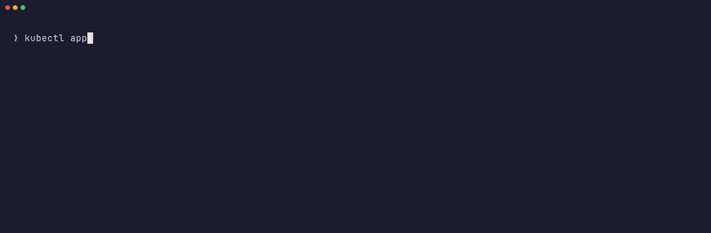
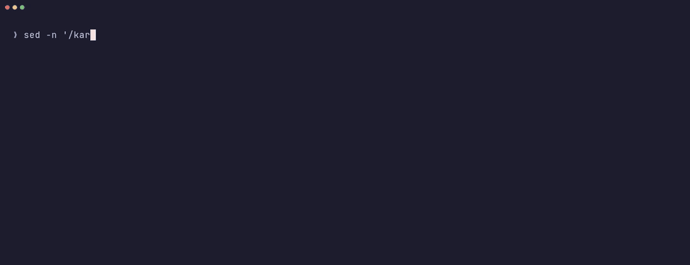

<p align="center">
  <picture>
    <source media="(prefers-color-scheme: dark)" srcset="docs/assets/logo-dark.svg">
    
  </picture>
</p>

<p align="center">
  <em>Run Kubernetes batch Jobs when the power is cleanest and the capacity is cheapest, and still meet the defined deadline.</em>
</p>

<p align="center">
  <a href="https://github.com/Thinnesen/offpeak/actions/workflows/test.yml"></a>
  <a href="https://github.com/Thinnesen/offpeak/actions/workflows/test-e2e.yml"></a>
  <a href="https://github.com/Thinnesen/offpeak/actions/workflows/security.yml"></a>
  
  
  
</p>

<p align="center">
  
  <br>
  <sub>Live data on a Kind cluster. The forecast for AWS us-west-2 moves a 2-hour job from the night to noon: 35&nbsp;% cleaner. Recorded with <a href="https://github.com/charmbracelet/vhs">VHS</a> (<a href="docs/demo/plan.tape">tape</a>).</sub>
</p>

---

Many batch jobs do not have to run *now*. They have to run *before a deadline*: tonight's report, tomorrow's model, the weekly backup.
**offpeak** uses that slack.

- **Plans** each Job in the window with the lowest carbon intensity or electricity price before its deadline, from forecasts that you weight.
- **Uses free and open data in every region**: grid CO2 forecasts, day-ahead prices, a renewable-share forecast, and a sun-and-wind proxy for any cloud region. No paid API is necessary.
- **Saves cloud money** with spot capacity first and an on-demand fallback that still meets the deadline.
- **Fits in**: plain Kubernetes Jobs, Karpenter NodePools and Argo Workflows. Nothing new to run in your pods.
- **Shows its work**: planned start, latest start, the estimate of every signal, how much of it is assumed, and the saving against "start now".

## See it run

<p align="center">
  
  <br>
  <sub><b>Plan, start, finish.</b> A short window: offpeak picks the start, creates the Job and mirrors its phase (<a href="docs/demo/run.tape">tape</a>).</sub>
</p>

<p align="center">
  
  <br>
  <sub><b>Spot first, deadline safe.</b> The demo cluster has no spot capacity. The spot Job stays pending, and offpeak starts the on-demand fallback in time (<a href="docs/demo/fallback.tape">tape</a>).</sub>
</p>

## Install

```sh
helm install offpeak oci://ghcr.io/thinnesen/charts/offpeak --version 0.1.0 \
  --namespace offpeak-system --create-namespace
```

Or apply one file from the [release](https://github.com/Thinnesen/offpeak/releases): `kubectl apply --server-side -f offpeak-0.1.0-install.yaml`.
The image and the chart are signed with cosign. The release notes show the `cosign verify` command.

## Quick start on Kind

You need Go, Docker and network access. Energi Data Service and Open-Meteo need no key.

```sh
make kind kubectl                       # pinned tools go into ./bin
export PATH="$PWD/bin:$PATH" KUBECONFIG="$PWD/bin/quickstart-kubeconfig"

kind create cluster --name offpeak --kubeconfig "$KUBECONFIG"
make docker-build IMG=offpeak:dev
kind load docker-image offpeak:dev --name offpeak
make install deploy IMG=offpeak:dev     # server-side apply: the DeferrableJob CRD is large
```

Create a signal source and a DeferrableJob:

```yaml
apiVersion: offpeak.thinnesen.com/v1alpha1
kind: SignalSource
metadata:
  name: us-west-2-weather
spec:
  weatherProxy:
    cloudRegion: aws:us-west-2         # sun and wind near the region, from Open-Meteo
---
apiVersion: offpeak.thinnesen.com/v1alpha1
kind: DeferrableJob
metadata:
  name: train-model
spec:
  deadline: "2026-10-20T06:00:00Z"     # a time in the future
  estimatedDuration: 2h                # include the node start-up time
  signals:
    - sourceRef: us-west-2-weather
      weight: 100
  jobTemplate:
    spec:
      template:
        spec:
          restartPolicy: Never
          containers:
            - name: train
              image: busybox:1.38.0
              command: ["sh", "-c", "echo training"]
```

```sh
kubectl get djob
NAME          PHASE     PLANNED START          DEADLINE               SAVINGS %   AGE
train-model   Waiting   2026-10-18T19:00:00Z   2026-10-20T06:00:00Z   35          7s
```

Remove the cluster with `kind delete cluster --name offpeak --kubeconfig "$KUBECONFIG"`. More samples are in [`config/samples/`](config/samples/).

## Signals

A `SignalSource` (cluster-scoped) configures one provider. A DeferrableJob refers to one or more of them, each with a weight.

| Provider | Data | Where | Key | Forecast |
|---|---|---|---|---|
| `weatherProxy` | Clean power index from the sun and wind forecast ([Open-Meteo](https://open-meteo.com)) | Every region. Use `cloudRegion` (46 AWS, Azure and GCP regions) or a coordinate. | No | 16 days |
| `ukCarbonIntensity` | Carbon intensity, gCO2eq/kWh ([National Grid ESO](https://carbonintensity.org.uk)) | Great Britain, 17 regions | No | 48 h |
| `energyCharts` | Share of the power that is not renewable, % ([Energy-Charts](https://energy-charts.info), Fraunhofer ISE) | 16 European countries | No | today, often tomorrow |
| `energiDataService` | CO2 prognosis (gCO2eq/kWh) or day-ahead price (EUR/MWh) | Denmark DK1, DK2 | No | 1 to 2 days |
| `entsoe` (experimental) | Day-ahead price, EUR/MWh ([ENTSO-E](https://transparency.entsoe.eu)) | All ENTSO-E bidding zones | Free token | up to 35 h |
| `electricityMaps` (experimental) | Carbon intensity, gCO2eq/kWh | Global zones | Paid for forecasts | 24 to 72 h |
| `awsSpot` (experimental) | Lowest spot price of the instance types, USD/h | All AWS regions | AWS credentials (read only) | none, history only |

**Read this before you expect large savings.**

- **Carbon is the strong signal in the cloud.** Grid carbon intensity often changes by a factor of 2 to 5 in one day.
- **Cloud prices hardly change with the time of day.** On-demand prices are flat. AWS smooths spot prices, and AWS publishes no forecast. The money in the cloud comes from spot capacity (see [Spot first, on-demand fallback](#spot-first-on-demand-fallback)), not from the start time.
- **The day-ahead price is the strong signal on premises.** Clusters that pay the electricity price directly can see swings of 5 to 10 times, and negative prices.
- **`weatherProxy` is a proxy.** More sun and wind near the region usually means cleaner power. But the index does not know the power plants, the imports or the demand. Use a measured source when one exists, or combine them with weights.

### Unknown future slots

A signal often does not cover the full time to the deadline. offpeak fills the gaps in this order:

1. **Profile.** Providers with history (Energi Data Service, ENTSO-E, AWS spot) compute the median for each hour of the week from the last 14 days. A future slot without data gets the median of its hour.
2. **Neutral value.** Where no profile exists, the planner uses the mean of the known values. A neutral value does not attract or repel the plan.

The status shows the assumed part of each estimate as `assumedPercent`. The controller plans again every 15 minutes until the Job starts, so new forecasts change the plan.

## How the plan works

1. Candidate starts: the earliest start, every 15 minutes (aligned in UTC), and the latest start that meets the deadline.
2. For each candidate and signal: the mean of the signal over the run.
3. Each signal is compared to its own "start now" value, so a signal that barely moves has little pull.
4. The plan is the candidate with the highest weighted saving against "start now". It is never worse than "start now". On a tie, the earliest start wins.
5. At the planned start, offpeak creates the Job (same name, owned by the DeferrableJob) and mirrors its phase.

If the deadline is too near to wait, the Job starts at once and `DeadlineAtRisk` is `True`. If all signals fail, offpeak retries every minute, and at the latest start the deadline wins.

## Karpenter

```yaml
spec:
  karpenter:
    nodePool: gpu
    instanceTypes: [g6.xlarge, g6.2xlarge]   # optional
    capacityType: SpotWithFallback          # Any (default) | Spot | OnDemand | SpotWithFallback
    fallbackMargin: 15m                     # default 15m
```

- offpeak reads the NodePool. If it does not exist, or it does not allow the capacity type, `KarpenterReady` is `False` and the Job waits.
- It adds the node selectors `karpenter.sh/nodepool` and `karpenter.sh/capacity-type`, and a node affinity for `instanceTypes`. It never changes a key that you set.
- The `awsSpot` signal uses `instanceTypes`, or the instance types of the NodePool. The cost model is the lowest spot price over the instance types and zones. This is close to the Karpenter `price-capacity-optimized` choice, but Karpenter can select another type or zone.

### Spot first, on-demand fallback

With `SpotWithFallback`, the deadline makes spot capacity safe:

1. offpeak plans the spot run so that it ends before `fallbackAt = deadline - estimatedDuration - fallbackMargin`.
2. It creates the Job on spot capacity. It adds a `podFailurePolicy` so that a spot interruption does not use up `backoffLimit` (only if you did not set one).
3. If the spot Job fails, disappears or is not complete at `fallbackAt`, offpeak deletes it and starts `<name>-od` on on-demand capacity. This happens one time.
4. If there is no time for a spot run at all, the Job starts on on-demand capacity at once.

`status.attempts` shows every Job with its capacity type and result. The fallback starts the work again from the start: offpeak does not checkpoint.

For AWS, give the service account `offpeak-controller-manager` in `offpeak-system` the permission `ec2:DescribeSpotPriceHistory` through EKS Pod Identity or IRSA. offpeak has no field for static keys.

## Argo Workflows

A workflow step can wait for the best window. Use an Argo `resource` template:

```yaml
- name: train
  resource:
    action: create
    setOwnerReference: true
    successCondition: status.phase == Succeeded
    failureCondition: status.phase == Failed
    manifest: |
      apiVersion: offpeak.thinnesen.com/v1alpha1
      kind: DeferrableJob
      metadata:
        generateName: train-
      spec: { ... }
```

The workflow service account needs `create`, `get`, `list`, `watch` and `patch` on `deferrablejobs`, and `create` and `patch` on `workflowtaskresults`. A full example with the RBAC is in [`docs/examples/argo-workflow.yaml`](docs/examples/argo-workflow.yaml). The e2e suite runs it with Argo Workflows v4.1.5.

## Security

- The controller reads Secrets only in its own namespace, with `get` through a namespaced Role and an uncached client. No `list` or `watch` on Secrets.
- It never logs a token or a URL with a token. Errors show only the host and path. Users cannot change the endpoint of a provider that sends a token.
- AWS credentials come only from the default credential chain (EKS Pod Identity or IRSA).
- The HTTP client has a 20-second timeout and a 32 MiB body limit, and it does not follow redirects.
- The pod runs as a non-root user with a read-only root file system, no privilege escalation, no capabilities and the `RuntimeDefault` seccomp profile.
- The image is distroless static. Images are pinned by digest, GitHub Actions by commit SHA, and downloaded tools by SHA-256.
- CI runs golangci-lint, govulncheck and a Trivy image scan. [`config/network-policy/allow-egress.yaml`](config/network-policy/allow-egress.yaml) is a sample egress policy.

## Limits

- The objective is the mean intensity or price over the run. offpeak does not model the energy use of an instance type.
- offpeak does not pause, preempt or move a running Job. After the start it only mirrors the Job, or starts the one on-demand fallback.
- Changes to the spec after the start have no effect.
- The public Open-Meteo API is free for non-commercial use. For commercial use, host Open-Meteo (open source) and set `--open-meteo-url`.
- `entsoe`, `electricityMaps` and `awsSpot` are experimental: they are tested with fixtures from the documented formats only. Please report problems with the live APIs. The providers that need no key have live tests (`make test-live`).
- Not yet: recurring schedules, price-aware NodePool weights, Prometheus metrics for savings.

## Development

```sh
make test          # unit and envtest tests
make lint          # golangci-lint
make vulncheck     # govulncheck
make test-live     # live tests of the providers that need no key
make test-e2e      # e2e on a dedicated Kind cluster, with Argo Workflows; deleted after the run
make scan-image IMG=offpeak:dev
hack/demo/cluster.sh && hack/demo/record.sh && hack/demo/gif.sh   # record the README demos
```

The design is in [`docs/DESIGN.md`](docs/DESIGN.md). Design changes are in [`docs/DECISIONS.md`](docs/DECISIONS.md).

## License

Apache License 2.0. See [`LICENSE`](LICENSE).
